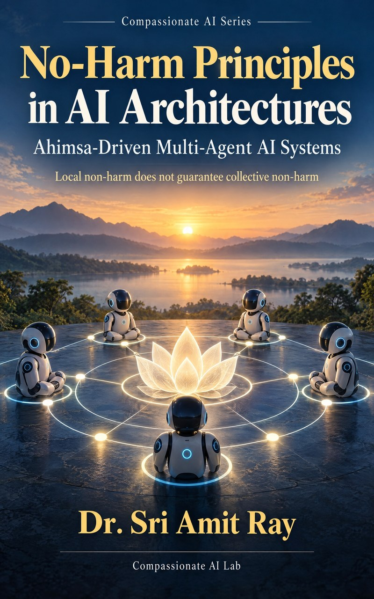

# No-Harm Principles in AI Architectures: companion code



Companion programs for the book **No-Harm Principles in AI Architectures: Ahimsa-Driven Multi-Agent AI Systems** by Dr. Sri Amit Ray ([Compassionate AI Lab](https://amitray.com/compassionate-ai-lab/), 2026; ISBN 978-81-69641-30-2 (First Edition, 2026)).

The book extends Ahimsa (non-injury) from the single AI agent to the multi-agent system: individual hard constraints, collective (joint-action) constraints enforced outside the agents, and the protocols and ledgers that keep responsibility reconstructible. This repository holds the program behind every worked example in the book, and a test file that checks each printed number.

## Run it

```sh
python models_no_harm_principles_in_ai_architectures.py     # prints every worked example
python -m unittest test_models.py                           # 16 tests, all numbers in the book
```

Python 3.8 or later; standard library only. `results.txt` is the output of the first command.

## What the program computes

| Chapter | Function(s) | Main result |
|---|---|---|
| 1 Emergent harm | `ch01_emergent_risk`, `ch01_chain_handoff`, `ch01_harm_screen` | corridor hazard 0.0444 against 0.0016 for independent drones; 4-handoff chain clean 88.53% |
| 2 Axioms | `ch02_least_harm_option` | least-harm choice D (π = 0.20) against the utility pick B |
| 3 Floors | `ch03_floor_coverage` | collective floor coverage 5/8 = 0.625 |
| 4 Joint feasibility | `ch04_joint_feasibility`, `collective_filter` | 6 joint plans, 4 feasible; greedy plan (1.70) is the worst violator, best feasible 1.50 |
| 5 Game theory | `ch05_floor_game` | equilibria found by checking every deviation: (D,D) 1.0 → (Dm,Dm) 2.2 → (C,C) 3.0 |
| 6 Trajectory harm | `ch06_trajectory_harm`, `ch06_early_escalation` | discounted 0.2720, vulnerability floor 0.3641, undiscounted 0.3950; slope rule warns 3 steps early |
| 7 Negotiation | `envelope_gate`, `ch07_negotiation_gate` | missing uncertainty → escalate |
| 8 Scheduling | `ch08_aging_scheduler`, `ch08_aging_with_deadline` | starvation removed by aging; 3-hour guaranteed deadline for the vulnerable class |
| 9 Ledgers | `ledger_build`, `ledger_verify`, `ch09_ledger_hash` | edited record found: 2 of 5 links valid, break at event 3 |
| 10 Healthcare | `ch10_patient_priority` | freshness gate, then Z: P1 = 0.825 gets the slot |
| 11 Drones | `ch11_drone_corridor`, `ch11_ground_exposure` | 42 m spacing, 28 slots; required envelope 13.5 > limit 12 → reroute at 8.1 |
| 12 Finance | `ch12_market_amplifier`, `ch12_flash_decay`, `aggregate_breaker` | 8 correlated agents at 2% → 5.5% aggregate; breaker halts new orders |
| 13 Governance | `ch13_floor_sets` | 1 shared floor, 6 in the union a cross-border system must hold |
| 14 Scaling | `ch14_capability_constraint`, `ch14_overrun_budget`, `ch14_required_constraint_rate` | gap 3.61× after 8 cycles; constraint growth 1.3129 keeps the margin at 0.80 |
| 15 Practice | `ch15_maturity`, `ch15_deployment_refusal` | maturity level 3 (gap at 4); refusal screen refuses one unmitigated mode |

The inputs are small illustrative values chosen so every step can be checked by hand. Replace them with values measured in your own deployment, and add a test for each case you rely on.

## Get the book

- Full-color PDF eBook: [amitray.com/no-harm-principles-ai-architectures-ebook](https://amitray.com/no-harm-principles-ai-architectures-ebook/)
- Paperback and Kindle: search Amazon for *No-Harm Principles in AI Architectures* by Sri Amit Ray

## Compassionate AI Key Articles

Articles by Dr. Sri Amit Ray that develop the frameworks the book builds on (the Compassionate AI Architecture, the Compassion Quotient, CHFOA, PRPA, agentic healthcare systems and medical drones), from the most recent:

- Ray, Amit. "The Ethics of Agentic AI: Accountability, Consent and Human Oversight When AI Acts for Us." *Compassionate AI*, 3.10 (2026): 18–20. [https://amitray.com/ethics-of-agentic-ai-accountability-oversight/](https://amitray.com/ethics-of-agentic-ai-accountability-oversight/)
- Ray, Amit. "AI Companions and the Human Heart: An Ethical Framework for Emotional AI, Loneliness and Children (2026)." *Compassionate AI*, 3.10 (2026): 18–20. [https://amitray.com/ai-companions-ethics-emotional-dependency/](https://amitray.com/ai-companions-ethics-emotional-dependency/)
- Ray, Amit. "The Top 12 LLM Benchmarks in 2026: A Complete Guide to Evaluating Large Language Models." *Compassionate AI*, 3.10 (2026): 1–5. [https://amitray.com/top-12-llm-benchmarks/](https://amitray.com/top-12-llm-benchmarks/)
- Ray, Amit. "Can Quantum AI Become Conscious? The Sri Amit Ray Framework for Spontaneous Machine Awareness." *Compassionate AI*, 3.9 (2026): 30–32. [https://amitray.com/can-quantum-ai-become-conscious-spontaneous-machine-awareness/](https://amitray.com/can-quantum-ai-become-conscious-spontaneous-machine-awareness/)
- Ray, Amit. "Heart Disease Prevention with Agentic AI: Tools, Techniques, Mathematical Models, and AI Architectures." *Compassionate AI*, 3.8 (2026): 78–80. [https://amitray.com/heart-disease-prevention-agentic-ai/](https://amitray.com/heart-disease-prevention-agentic-ai/)
- Ray, Amit. "Compassionate AI in Health Care: A Comprehensive Review (2026)." *Compassionate AI*, 3.8 (2026): 63–65. [https://amitray.com/compassionate-ai-in-health-care-a-comprehensive-review/](https://amitray.com/compassionate-ai-in-health-care-a-comprehensive-review/)
- Ray, Amit. "The 25 Algorithms of the Sri Amit Ray Compassionate AI Architecture." *Compassionate AI*, 3.8 (2026): 63–65. [https://amitray.com/ray-25-compassionate-ai-algorithms/](https://amitray.com/ray-25-compassionate-ai-algorithms/)
- Ray, Amit. "Human-AI Emotional Resonance Algorithm: Ethical Emotional Co-Regulation in the Sri Amit Ray Compassionate AI Architecture (CAIA)." *Compassionate AI*, 2.6 (2026): 81–83. [https://amitray.com/human-ai-emotional-resonance-algorithm-compassionate-ai/](https://amitray.com/human-ai-emotional-resonance-algorithm-compassionate-ai/)
- Ray, Amit. "Build Your Own Agentic AI Healthcare MCP Server: A Complete Guide to AI-Powered Healthcare Agents." *Compassionate AI*, 3.8 (2026): 60–62. [https://amitray.com/agentic-ai-healthcare-mcp-server/](https://amitray.com/agentic-ai-healthcare-mcp-server/)
- Ray, Amit. "Medical AI Drones for Disaster Management: Intelligent Unmanned Health-Care Systems." *Compassionate AI*, 3.8 (2026): 57–59. [https://amitray.com/medical-ai-drones-for-disaster-management/](https://amitray.com/medical-ai-drones-for-disaster-management/)
- Ray, Amit. "Compassionate Medical AI Drones as Intelligent Unmanned Health-Care Systems: A Human-Centered AI Architecture for Suffering Reduction and Human Flourishing." *Compassionate AI*, 3.8 (2026): 57–59. [https://amitray.com/medical-ai-drones-human-centered-ai-healthcare/](https://amitray.com/medical-ai-drones-human-centered-ai-healthcare/)
- Ray, Amit. "The Sri Amit Ray Compassion Quotient (CQ) Algorithm for Compassionate AI." *Compassionate AI*, 2.6 (2026): 81–83. [https://amitray.com/compassion-quotient-cq-algorithm-compassionate-ai/](https://amitray.com/compassion-quotient-cq-algorithm-compassionate-ai/)
- Ray, Amit. "Collective Human Flourishing Optimization AI Algorithm (CHFOA): A Compassion-Centered Multi-Stakeholder AI Optimization Framework." *Compassionate AI*, 2.6 (2026): 90–92. [https://amitray.com/collective-human-flourishing-optimization-algorithm-chfoa/](https://amitray.com/collective-human-flourishing-optimization-algorithm-chfoa/)
- Ray, Amit. "Human Flourishing Optimization Algorithm (HFOA) for Compassionate AI Architecture." *Compassionate AI*, 2.6 (2026): 81–83. [https://amitray.com/human-flourishing-optimization-algorithm-hfoa-compassionate-ai/](https://amitray.com/human-flourishing-optimization-algorithm-hfoa-compassionate-ai/)
- Ray, Amit. "The Sri Amit Ray Compassionate AI Architecture (CAIA): A Seven-Layer Framework for Human-Centered Artificial Intelligence." *Compassionate AI*, 2.6 (2026): 81–83. [https://amitray.com/compassionate-ai-architecture/](https://amitray.com/compassionate-ai-architecture/)
- Ray, Amit. "Human-Centered Compassionate AI: The 25 Algorithms for Protecting Humanity and Future Generations." *Compassionate AI*, 2.6 (2026): 30–32. [https://amitray.com/human-centered-compassionate-ai-the-25-algorithms/](https://amitray.com/human-centered-compassionate-ai-the-25-algorithms/)
- Ray, Amit. "AI Consciousness and Self-Aware Robots: Sri Amit Ray’s Framework for Compassionate Intelligence." *Compassionate AI*, 2.5 (2026): 57–59. [https://amitray.com/ai-consciousness-self-aware-robots/](https://amitray.com/ai-consciousness-self-aware-robots/)
- Ray, Amit. "The 12 Sri Amit Ray Compassionate AI Principles | Ethical AI Framework." *Compassionate AI*, 2.4 (2026): 12–14. [https://amitray.com/the-12-compassionate-ai-principles-for-humanity-and-future-generations/](https://amitray.com/the-12-compassionate-ai-principles-for-humanity-and-future-generations/)
- Ray, Amit. "The Compassionate AI Lab Declaration on AI Safety, Suffering Reduction, and the Protection of Humanity." *Compassionate AI*, 4.12 (2025): 72–74. [https://amitray.com/compassionate-ai-declaration-protection-of-humanity/](https://amitray.com/compassionate-ai-declaration-protection-of-humanity/)
- Ray, Amit. "Compassionate AI for Forward Deployed Engineers (FDEs) in SaaS Companies." *Compassionate AI*, 4.11 (2025): 15–17. [https://amitray.com/compassionate-ai-for-forward-deployed-engineers-fdes-in-saas-companies/](https://amitray.com/compassionate-ai-for-forward-deployed-engineers-fdes-in-saas-companies/)
- Ray, Amit. "Microbial AI, Bioleaching and Digital Twins for Manufacturing the 17 Rare Earth Elements." *Compassionate AI*, 4.10 (2025): 42–44. [https://amitray.com/microbial-ai-bioleaching-and-digital-twins-for-manufacturing-the-17-rare-earth-elements/](https://amitray.com/microbial-ai-bioleaching-and-digital-twins-for-manufacturing-the-17-rare-earth-elements/)
- Ray, Amit. "AI-Driven Rare Earth Element Magnet Design: Detailed Methodologies." *Compassionate AI*, 4.10 (2025): 27–29. [https://amitray.com/ai-driven-rare-earth-elements-magnet-design-methodologies/](https://amitray.com/ai-driven-rare-earth-elements-magnet-design-methodologies/)
- Ray, Amit. "AI Agents and Robots in Peacekeeping Force and Social Care: Compassionate AI Technologies." *Compassionate AI*, 3.9 (2025): 75–77. [https://amitray.com/ai-agents-robots-peacekeeping-force-social-care-compassionate-ai/](https://amitray.com/ai-agents-robots-peacekeeping-force-social-care-compassionate-ai/)
- Ray, Amit. "Ray Mother–Infant Inter-brain Synchrony Algorithm for Deep Compassionate AI." *Compassionate AI*, 3.9 (2025): 60–62. [https://amitray.com/ray-mother-infant-inter-brain-synchrony-algorithm-deep-compassionate-ai/](https://amitray.com/ray-mother-infant-inter-brain-synchrony-algorithm-deep-compassionate-ai/)
- Ray, Amit. "Pain Recognition and Prediction AI Algorithm (PRPA) for Compassionate AI." *Compassionate AI*, 3.9 (2025): 60–62. [https://amitray.com/pain-recognition-and-prediction-algorithm-prpa-for-compassionate-ai/](https://amitray.com/pain-recognition-and-prediction-algorithm-prpa-for-compassionate-ai/)
- Ray, Amit. "Modeling Consciousness in Compassionate AI: Transformer Models and EEG Data Verification." *Compassionate AI*, 3.9 (2025): 27–29. [https://amitray.com/modeling-consciousness-in-compassionate-ai-transformer-models/](https://amitray.com/modeling-consciousness-in-compassionate-ai-transformer-models/)
- Ray, Amit. "The 7 Pillars of Compassionate AI Democracy." *Compassionate AI*, 3.9 (2024): 84–86. [https://amitray.com/the-7-pillars-of-compassionate-ai-democracy/](https://amitray.com/the-7-pillars-of-compassionate-ai-democracy/)
- Ray, Amit. "Compassionate AI-Driven Democracy: Power and Challenges." *Compassionate AI*, 3.9 (2024): 48–50. [https://amitray.com/compassionate-ai-driven-democracy-power-and-challenges/](https://amitray.com/compassionate-ai-driven-democracy-power-and-challenges/)
- Ray, Amit. "The 10 Ethical AI Indexes for LLM Data Training and Responsible AI." *Compassionate AI*, 3.8 (2023): 35–39. [https://amitray.com/the-10-ethical-ai-indexes-for-responsible-ai/](https://amitray.com/the-10-ethical-ai-indexes-for-responsible-ai/)
- Ray, Amit. "Ethical Responsibilities in Large Language AI Models: GPT-3, GPT-4, PaLM 2, LLaMA, Chinchilla, Gopher, and BLOOM." *Compassionate AI*, 3.7 (2023): 21–23. [https://amitray.com/ethical-responsibility-in-large-language-ai-models/](https://amitray.com/ethical-responsibility-in-large-language-ai-models/)
- Ray, Amit. "Calling for a Compassionate AI Movement: Towards Compassionate Artificial Intelligence." *Compassionate AI*, 2.6 (2023): 75–77. [https://amitray.com/calling-for-a-compassionate-ai-movement/](https://amitray.com/calling-for-a-compassionate-ai-movement/)
- Ray, Amit. "From Data-Driven AI to Compassionate AI: Safeguarding Humanity and Empowering Future Generations." *Compassionate AI*, 2.6 (2023): 51–53. [https://amitray.com/from-data-driven-ai-to-compassionate-ai-safeguarding-humanity-and-empowering-future-generations/](https://amitray.com/from-data-driven-ai-to-compassionate-ai-safeguarding-humanity-and-empowering-future-generations/)
- Ray, Amit. "Artificial intelligence for Climate Change, Biodiversity and Earth System Models." *Compassionate AI*, 1.1 (2022): 54–56. [https://amitray.com/artificial-intelligence-for-climate-change-and-earth-system-models/](https://amitray.com/artificial-intelligence-for-climate-change-and-earth-system-models/)
- Ray, Amit. "Artificial Intelligence for Balance Control and Fall Detection of Elderly People." *Compassionate AI*, 4.10 (2018): 39–41. [https://amitray.com/artificial-intelligence-for-balance-control-and-fall-detection-system-of-elderly-people/](https://amitray.com/artificial-intelligence-for-balance-control-and-fall-detection-system-of-elderly-people/)
- Ray, Amit. "Artificial Intelligence to Combat Antibiotic Resistant Bacteria." *Compassionate AI*, 2.6 (2018): 3–5. [https://amitray.com/artificial-intelligence-for-antibiotic-resistant-bacteria/](https://amitray.com/artificial-intelligence-for-antibiotic-resistant-bacteria/)
- Ray, Amit. "Navigation System for Blind People Using Artificial Intelligence." *Compassionate AI*, 2.5 (2018): 42–44. [https://amitray.com/artificial-intelligence-for-assisting-blind-people/](https://amitray.com/artificial-intelligence-for-assisting-blind-people/)
- Ray, Amit. "Brain-Computer Interface and Compassionate Artificial Intelligence." *Compassionate AI*, 2.5 (2018): 3–5. [https://amitray.com/brain-computer-interface-compassionate-ai/](https://amitray.com/brain-computer-interface-compassionate-ai/)

## Cite as

**Book (MLA):**
Ray, Sri Amit. *No-Harm Principles in AI Architectures: Ahimsa-Driven Multi-Agent AI Systems*. Compassionate AI Lab, 2026. ISBN 978-81-69641-30-2.

**Book (APA):**
Ray, S. A. (2026). *No-harm principles in AI architectures: Ahimsa-driven multi-agent AI systems*. Compassionate AI Lab.

**Companion code:**
Ray, S. A. (2026). *No-Harm Principles in AI Architectures: companion code* [Computer software]. Compassionate AI Lab. https://github.com/compassionate-ai-lab/no-harm-principles

**BibTeX:**

```bibtex
@book{ray2026noharm,
  author    = {Ray, Sri Amit},
  title     = {No-Harm Principles in AI Architectures: Ahimsa-Driven Multi-Agent AI Systems},
  publisher = {Compassionate AI Lab},
  year      = {2026},
  isbn      = {978-81-69641-30-2},
  url       = {https://github.com/compassionate-ai-lab/no-harm-principles}
}
```

GitHub's **Cite this repository** button (from `CITATION.cff`) gives the same reference in APA and BibTeX.

## Corrections

Please report errors through the repository's Issues page. Corrections to the book will be listed here.

## Licence

The code in this repository is released under the MIT License (see `LICENSE`). The text of the book is © 2026 Dr. Sri Amit Ray, all rights reserved.

About the lab: [Compassionate AI Lab](https://amitray.com/compassionate-ai-lab/) · More of the author's work: https://amitray.com
